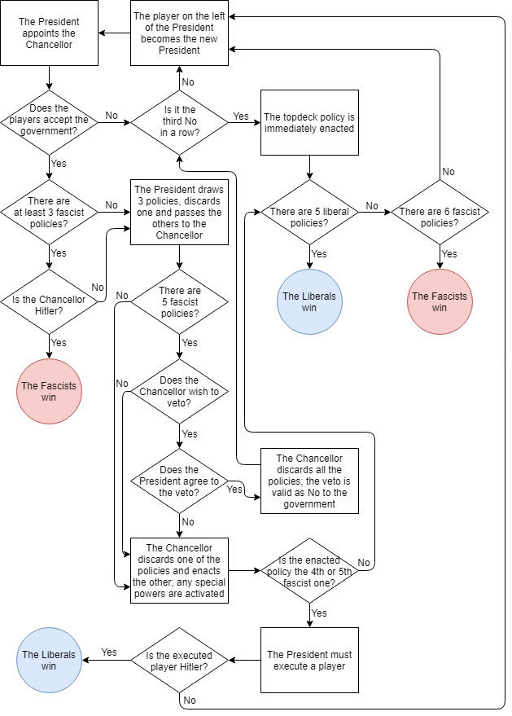

# Secret Hitler - Firebase API

This project is the backend for the Secret Hitler game, intended to be deployed to Firebase Functions. It is designed to
work with the frontend implemented using SvelteKit, deployed to Firebase Hosting.

Secret Hitler Svelte : https://github.com/touficbatache/SecretHitlerSvelte

## Flow sheet



## How to install?

```shell
git clone https://github.com/touficbatache/SecretHitlerFirebase.git
cd SecretHitlerFirebase
npm install
```

This API is supposed to be deployed to a Firebase project.

I - First, you will need to install the Firebase CLI using the following command:

```shell
npm install -g firebase-tools
```

**Note:** The `-g` flag installs a package (here Firebase CLI) globally, which allows you
to call it from any command line on your local computer.

II - Then, you'll have to create a Firebase project with the following features turned on:

- Authentication
- Functions
- Realtime Database

and login:

```shell
firebase login
```

III - Link the project you just created by running the following command:

```shell
npm run link --project=[PROJECTNAME]
```

## Run in dev mode

Inside to the `functions/` directory, make sure to set the correct environment variable values for development
in `.env`.

Then execute the following command, which listens to code changes when building and runs the Firebase Emulator locally:

```shell
npm run serve
```

The Emulator UI can be accessed using the URL shown in the terminal, usually http://localhost:4002/.

`DEV=true` turns on dev mode: authentication and role checks are skipped and fake player ids are generated, so one
client can simulate a whole game. It only works inside the emulator. Deployed functions ignore it, so a `DEV=true`
copied into `.env.[PROJECTNAME]` by `npm run link` can't disable authentication in production.

In dev mode, a request with an `X-Dev-Uid: [PLAYER_ID]` header acts as that player instead, with every check applied,
as if they were logged in. The tests use it to check whose turn it is.

## Tests

The rules engine (`functions/src/engine`, see its [README](functions/src/engine/README.md)) has its own
tests, which need no emulator and run in seconds, along with the tests of the adapter between the
database and the engine. From `functions/`:

```shell
npm run test:engine
```

The other tests play games through the API against the Firebase emulators (functions and database), in
dev mode. They cover the game rules, concurrent requests, phase timing, lobbies and the database
security rules. From `functions/`:

```shell
npm test
```

This runs the engine tests, then builds the functions, starts the emulators on the `demo-shtest` project (`DEV=true` comes from
`functions/.env.demo-shtest`), runs every file in `functions/test/` and stops the emulators. A
`functions/.env.local` file also applies to the emulator: make sure it doesn't set `DEV=false`.

`npm run lint` checks the formatting and the lint rules (`npm run lint:fix` fixes what it can). GitHub
Actions runs the lint and all the tests on every pull request and on `master`
(`.github/workflows/ci.yml`).

## Deploy to production

Every merge to `master` deploys itself: once the tests pass, GitHub Actions deploys the functions
and the database security rules to the Firebase project (`.github/workflows/ci.yml`). The app
([SecretHitlerSvelte](https://github.com/touficbatache/SecretHitlerSvelte)) deploys the same way
from its own repository.

To deploy by hand instead, from `functions/`:

```shell
firebase deploy --only functions,database --project [PROJECTNAME]
```

### Continuous deployment: one-time setup

GitHub Actions logs in to Google Cloud without a stored key (Workload Identity Federation): GitHub
proves to Google that the job runs on `master` of one of the two repositories, and Google lets it
act as a deploy-only service account. Run this once with the
[gcloud CLI](https://cloud.google.com/sdk/docs/install), logged in as an owner of the project:

```shell
PROJECT_ID=[PROJECTNAME]
PROJECT_NUMBER=$(gcloud projects describe $PROJECT_ID --format='value(projectNumber)')
DEPLOYER=github-deploy@$PROJECT_ID.iam.gserviceaccount.com

# The keyless login, and the billing check the Firebase CLI runs before deploying functions
gcloud services enable iamcredentials.googleapis.com sts.googleapis.com cloudbilling.googleapis.com \
  --project $PROJECT_ID

# Only the master branch of these two repositories can log in
gcloud iam workload-identity-pools create github --project $PROJECT_ID --location global
gcloud iam workload-identity-pools providers create-oidc github --project $PROJECT_ID \
  --location global --workload-identity-pool github \
  --issuer-uri https://token.actions.githubusercontent.com \
  --attribute-mapping 'google.subject=assertion.sub,attribute.repository=assertion.repository' \
  --attribute-condition "assertion.repository in ['touficbatache/SecretHitlerFirebase', 'touficbatache/SecretHitlerSvelte'] && assertion.ref == 'refs/heads/master'"

# The account the deploys run as, with what deploying the functions, the rules and the app needs
gcloud iam service-accounts create github-deploy --project $PROJECT_ID
for role in firebase.admin cloudfunctions.admin run.admin cloudbuild.builds.editor \
  artifactregistry.writer iam.serviceAccountUser serviceusage.serviceUsageConsumer \
  serviceusage.apiKeysViewer; do
  gcloud projects add-iam-policy-binding $PROJECT_ID --member serviceAccount:$DEPLOYER \
    --role roles/$role --condition None
done

for repo in SecretHitlerFirebase SecretHitlerSvelte; do
  gcloud iam service-accounts add-iam-policy-binding $DEPLOYER --project $PROJECT_ID \
    --role roles/iam.workloadIdentityUser \
    --member "principalSet://iam.googleapis.com/projects/$PROJECT_NUMBER/locations/global/workloadIdentityPools/github/attribute.repository/touficbatache/$repo"
done

# Lets deploys clean up old function images without asking (a deploy can't answer questions)
firebase functions:artifacts:setpolicy --project $PROJECT_ID

echo "GCP_WORKLOAD_IDENTITY_PROVIDER = projects/$PROJECT_NUMBER/locations/global/workloadIdentityPools/github/providers/github"
echo "GCP_SERVICE_ACCOUNT = $DEPLOYER"
echo "FIREBASE_PROJECT = $PROJECT_ID"
```

Then, in **both** repositories on GitHub (Settings, Secrets and variables, Actions, Variables), add
the three repository variables the last commands print. None of them is a secret. The app's
repository also needs its production `.env` file as a secret: see its README.

A deploy that can't log in fails with a message naming what's missing. The deploys appear under
the `production` environment on GitHub, where an approval step can be added later (Settings,
Environments, production, Required reviewers).

## API description

http://127.0.0.1:5001/[project-id]/us-central1/api/[route]/

### ==== Create a new game ====

**Request:**

`POST /newGame/`

```
NO BODY
```

**Response:**

```http request
HTTP/1.1 201 Created
content-type: application/json

{ "code": "[GAMECODE]" }
```

### ==== Join a game ====

**Request:**

`POST /joinGame/`

```json
{
  "code": "[GAMECODE]"
}
```

**Response:**

```http request
HTTP/1.1 200 OK
content-type: application/json

{ "code": "[GAMECODE]" }
```

### ==== Game owner: start the game ====

*⚠️ GAME OWNER ONLY ⚠️*

**Request:**

`POST /startGame/`

```json
{
  "code": "[GAMECODE]",
  "hidePicsGameInfo": "[BOOLEAN]",
  "skipLongIntro": "[BOOLEAN]"
}
```

**Response:**

```http request
HTTP/1.1 200 OK
content-type: application/json

{ "code": "[GAMECODE]" }
```

### ==== Play a move ====

Every game move goes through this endpoint. The player is the one logged in, and the rules engine
decides whether it's their turn (see [the engine's README](functions/src/engine/README.md)).

**Request:**

`POST /action/`

```json
{
  "code": "[GAMECODE]",
  "actionId": "[A NEW ID FOR EACH MOVE, LIKE A UUID]",
  "action": { "type": "vote", "ja": true }
}
```

| `action` | Who | When |
|---|---|---|
| `{ "type": "nominate", "chancellorId": "[PLAYER_ID]" }` | President | Choosing a Chancellor |
| `{ "type": "vote", "ja": [BOOLEAN] }` | Every living player, once | Voting |
| `{ "type": "discard", "policy": "liberal" \| "fascist" }` | President, then Chancellor | Legislative session |
| `{ "type": "proposeVeto" }` | Chancellor | Discarding, with 5 fascist policies enacted |
| `{ "type": "answerVeto", "accept": [BOOLEAN] }` | President | A veto was proposed |
| `{ "type": "usePower", "targetId": "[PLAYER_ID]" }` | President | A presidential power. No target for the policy peek |
| `{ "type": "endPower" }` | President | Closing the policy peek or the investigation result |

`actionId` is optional but recommended (up to 64 letters, digits, `-` or `_`). Once a move has
succeeded, sending the same request again with the same `actionId` gets the same response and
changes nothing, so a client can safely retry a request whose response it never received.

**Response:**

```http request
HTTP/1.1 200 OK
content-type: application/json

{ "code": "[GAMECODE]" }
```

A policy peek also returns `"policies": "[POLICY],[POLICY],[POLICY]"`, and an investigation
`"membership": "liberal" | "fascist"`.

The routes from before `/action` (`/chooseChancellor`, `/vote`, `/presidentDiscardPolicy`,
`/chancellorDiscardPolicy`, `/askForVeto`, `/answerVeto`, `/presidentialPower`) still work, so apps
loaded before a deploy keep working. They will be removed.

### ==== Move on after a pause ====

The game pauses between some phases: the intro (5s, or 30s for the long intro), and 5s to show the
votes, an enacted policy or a power's result. The server doesn't wait during a pause: it writes the
next step in the game's `pendingTransition` node, as `{ "at": [SERVER TIME IN MS], "kind": "..." }`.

Clients show the pause until `at` (on the server's clock, with `.info/serverTimeOffset`), then call
this endpoint to apply it. Any request on the game also applies it once it's due. Moves sent
during a pause get a `PAUSED` error.

**Request:**

`POST /advance/`

```json
{
  "code": "[GAMECODE]"
}
```

**Response:**

```http request
HTTP/1.1 200 OK
content-type: application/json

{ "code": "[GAMECODE]", "pendingTransitionAt": "[SERVER TIME IN MS, IF A PAUSE IS STILL ON]" }
```

### ==== GAME END ====

Game will end automatically and a team will win depending on one of these conditions:

**Liberal team:**

- 5 liberal policies have been enacted, or
- Hitler is executed

**Fascist team:**

- 6 fascist policies have been enacted, or
- Hitler is elected Chancellor after 3 or more fascist policies are enacted

### Error responses

Every error has a standard HTTP status and a code to act on:

```http request
HTTP/1.1 403 Forbidden
content-type: application/json

{ "error": { "code": "NOT_YOUR_TURN", "message": "It's not this player's turn" } }
```

| Code | Status | Meaning |
|---|---|---|
| `UNAUTHENTICATED` | 401 | Not logged in, or the login or App Check token is invalid |
| `INVALID_REQUEST` | 400 | A field is missing or has the wrong type |
| `GAME_NOT_FOUND` | 404 | No game with this code |
| `NOT_IN_GAME` | 403 | The player isn't in this game |
| `NOT_OWNER` | 403 | Only the game's owner can do this |
| `NOT_YOUR_TURN` | 403 | Another player has to act now |
| `WRONG_PHASE` | 409 | The game has moved on, or hasn't started: the move was meant for another phase |
| `PAUSED` | 409 | A result is showing: moves resume when the pause is over |
| `GAME_BUSY` | 409 | Another request on this game took more than 15 seconds. Retrying is safe |
| `ALREADY_IN_GAME` | 409 | The player already joined this game |
| `GAME_FULL` | 409 | The game has 10 players |
| `GAME_STARTED` | 409 | The game has already started |
| `INELIGIBLE` | 422 | This player can't be chosen: dead, term-limited, investigated before... |
| `INVALID_ACTION` | 422 | This move isn't possible, like discarding a policy that isn't in hand |
| `NOT_ENOUGH_PLAYERS` | 422 | A game needs at least 5 players |
| `INTERNAL` | 500 | Something went wrong. The details are only in the function logs |
